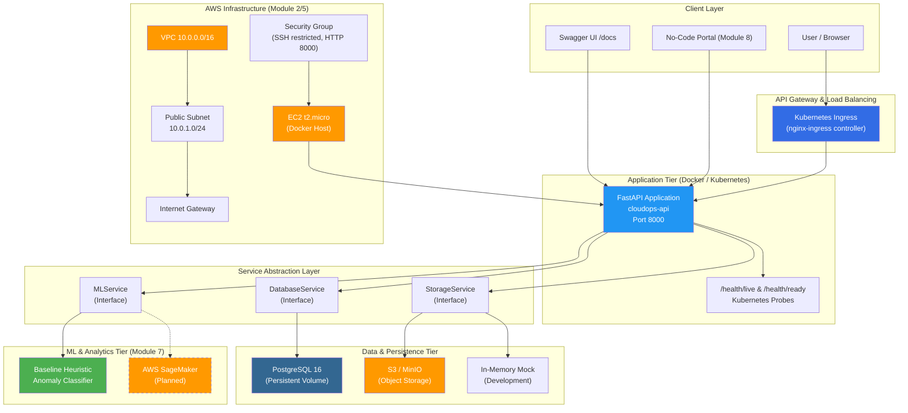
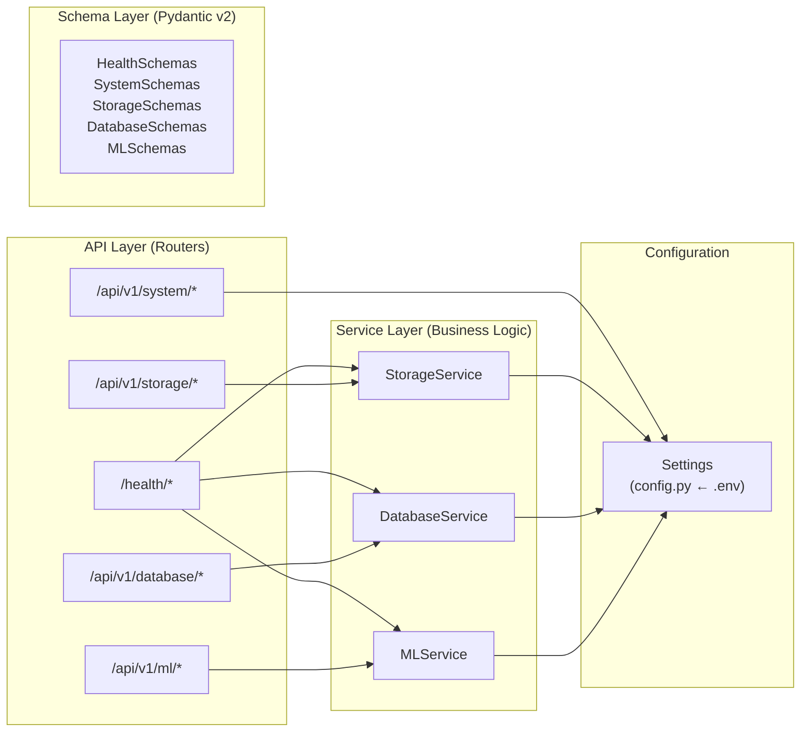
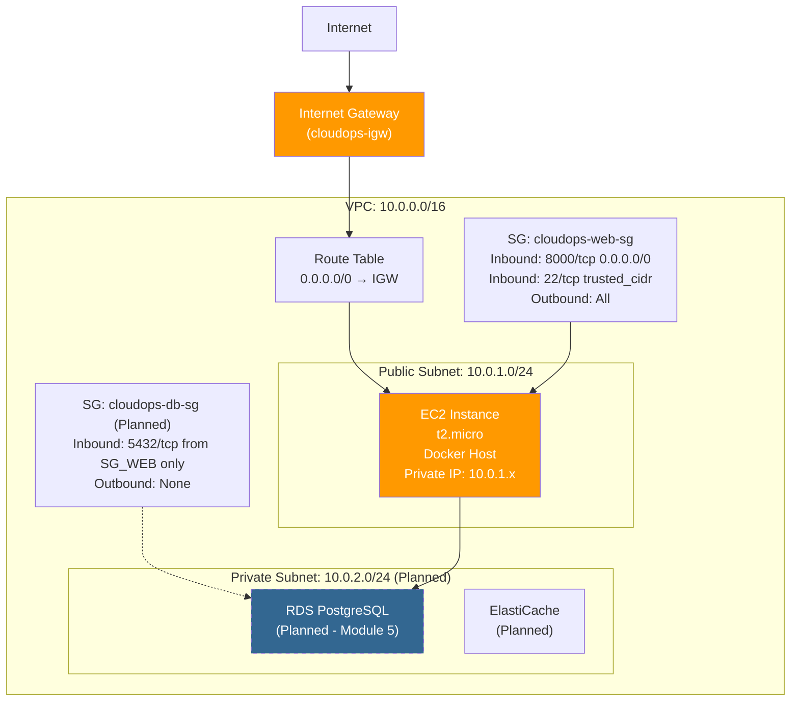
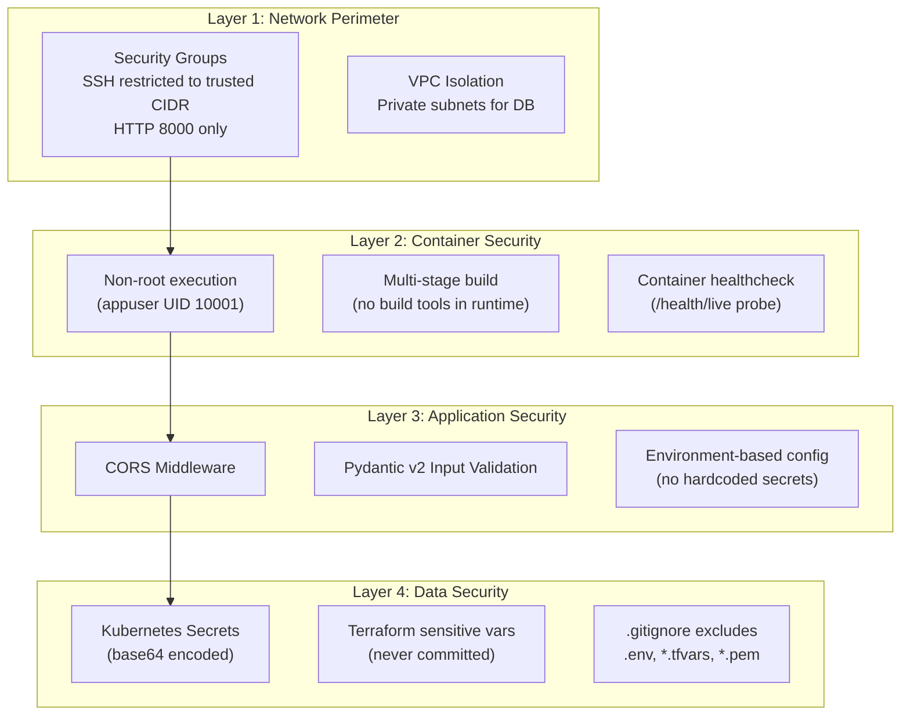
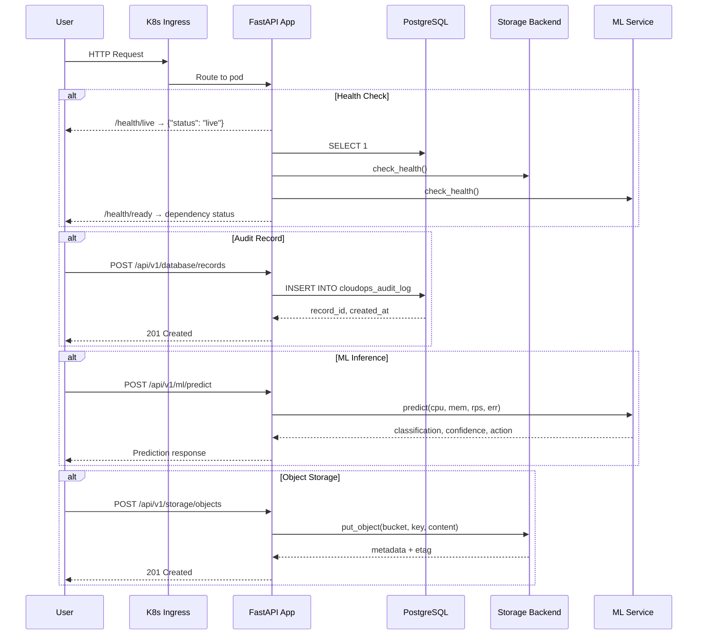
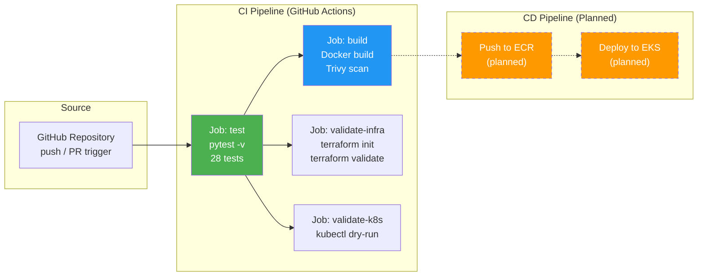
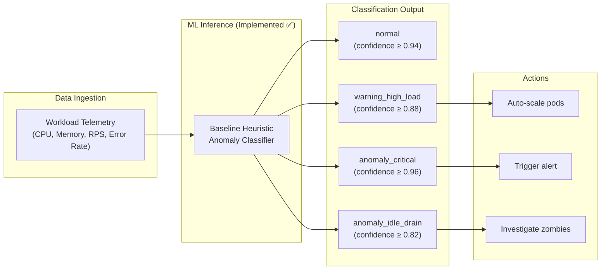

# CloudOps Enterprise Platform — Architecture Documentation

> **Module 1–8 Cloud Infrastructure, Automation & Deployment Ecosystem**  
> This document describes the complete architecture for the CloudOps Enterprise Platform capstone project.

---

## Table of Contents

1. [System Architecture Overview](#1-system-architecture-overview)
2. [High-Level Architecture Diagram](#2-high-level-architecture-diagram)
3. [Component Architecture](#3-component-architecture)
4. [VPC & Cloud Networking Design (Module 2)](#4-vpc--cloud-networking-design-module-2)
5. [Security Architecture (Module 4)](#5-security-architecture-module-4)
6. [Data Flow Architecture](#6-data-flow-architecture)
7. [Virtualization vs Containerization (Module 1)](#7-virtualization-vs-containerization-module-1)
8. [Deployment Architecture](#8-deployment-architecture)
9. [CI/CD Pipeline Architecture (Module 6)](#9-cicd-pipeline-architecture-module-6)
10. [Big Data & ML Pipeline Architecture (Module 7)](#10-big-data--ml-pipeline-architecture-module-7)
11. [No-Code Integration Architecture (Module 8)](#11-no-code-integration-architecture-module-8)
12. [Implementation Status](#12-implementation-status)

---

## 1. System Architecture Overview

The CloudOps Enterprise Platform is a **cloud-native microservices ecosystem** built with FastAPI (Python), containerized with Docker, orchestrated via Kubernetes, and designed for deployment on AWS infrastructure provisioned through Terraform IaC.

### Design Principles

- **Twelve-Factor App Methodology** — Environment-driven configuration, stateless processes, disposable containers
- **Clean Architecture** — Separation of API routers, business logic services, and data schemas
- **Pluggable Backend Interfaces** — Abstract service interfaces (`StorageService`, `MLService`, `DatabaseService`) allow swapping between local mocks and production cloud backends via environment variables
- **Security by Default** — Non-root container execution, least-privilege IAM, encrypted secrets, SSH restricted to trusted CIDRs

---

## 2. High-Level Architecture Diagram



---

## 3. Component Architecture

### 3.1 FastAPI Application (Module 3 — Implemented ✅)

The core application follows a layered architecture:



### 3.2 Service Interface Design

Each backend is abstracted behind a clean Python ABC interface:

| Service Interface | Local Implementation | Production Implementation | Selector Env Var |
|:---|:---|:---|:---|
| `StorageService` | `InMemoryStorageService` | `S3StorageService` (boto3) | `STORAGE_BACKEND=local_memory\|s3\|minio` |
| `DatabaseService` | `MockDatabaseService` | `PostgresDatabaseService` (psycopg 3) | `DB_BACKEND=mock\|postgres` |
| `MLService` | `LocalBaselineMLService` | SageMaker endpoint (planned) | `ML_BACKEND=local_baseline` |

### 3.3 API Endpoint Inventory

| Category | Endpoints | Spec Module |
|:---|:---|:---|
| Health Probes | `GET /health/live`, `GET /health/ready`, `GET /health` | Module 3/4 |
| System & Arch | `GET /api/v1/system/metrics`, `GET /api/v1/system/architecture`, `GET /api/v1/system/modules` | Module 1 |
| Object Storage | `GET/POST /api/v1/storage/objects`, `GET/DELETE /api/v1/storage/objects/{key}`, `GET /api/v1/storage/info`, `GET /api/v1/storage/buckets` | Module 2 |
| Database | `GET /api/v1/database/info`, `POST/GET /api/v1/database/records` | Module 2 |
| ML Inference | `GET /api/v1/ml/info`, `GET /api/v1/ml/models`, `POST /api/v1/ml/predict` | Module 7 |

---

## 4. VPC & Cloud Networking Design (Module 2)

### 4.1 Network Topology



### 4.2 Addressing Plan

| Resource | CIDR / Address | Purpose |
|:---|:---|:---|
| VPC | `10.0.0.0/16` | Primary VPC (65,536 IPs) |
| Public Subnet | `10.0.1.0/24` | Internet-facing EC2 instances (256 IPs) |
| Private Subnet | `10.0.2.0/24` | RDS, ElastiCache — no direct internet (planned) |
| Internet Gateway | Attached to VPC | Outbound NAT for public subnet |
| Route Table | `0.0.0.0/0 → IGW` | Default route for public subnet |

### 4.3 Security Groups

| Security Group | Inbound Rules | Outbound |
|:---|:---|:---|
| `cloudops-web-sg` | TCP 8000 from `0.0.0.0/0` (HTTP API), TCP 22 from `var.trusted_ssh_cidr` only | All traffic |
| `cloudops-db-sg` (planned) | TCP 5432 from `cloudops-web-sg` only | None |

### 4.4 Storage & Data Layer

| Service | Type | Implementation | Lifecycle Policy |
|:---|:---|:---|:---|
| PostgreSQL | Relational DB | Docker container / RDS (planned) | Persistent volume `cloudops_postgres_data` |
| S3/MinIO | Object Storage | In-memory mock / S3StorageService (ready) | Standard-IA → Glacier transition (planned) |
| Audit Logs | Append-only table | `cloudops_audit_log` table in PostgreSQL | Retained indefinitely |

---

## 5. Security Architecture (Module 4)

### 5.1 Defense in Depth



### 5.2 IAM Principle of Least Privilege (Planned)

| Role | Permissions | Applied To |
|:---|:---|:---|
| `cloudops-ec2-role` | EC2 describe, S3 read/write to `cloudops-*` buckets, CloudWatch logs | EC2 instance profile |
| `cloudops-cicd-role` | ECR push, ECS deploy, S3 artifacts | GitHub Actions OIDC |
| `cloudops-rds-user` | SELECT, INSERT, UPDATE on `cloudops_db` only | Application PostgreSQL user |

### 5.3 Encryption Strategy (Planned)

| Layer | At Rest | In Transit |
|:---|:---|:---|
| S3 Objects | AES-256 (SSE-S3) or KMS | TLS 1.2+ HTTPS |
| RDS Database | AES-256 KMS-managed | TLS/SSL connection required |
| Docker Images | ECR encryption | Registry HTTPS |
| Kubernetes Secrets | etcd encryption | TLS between pods |

---

## 6. Data Flow Architecture



---

## 7. Virtualization vs Containerization (Module 1)

### 7.1 Technical Comparison Matrix

| Dimension | Virtual Machine (IaaS) | Docker Container | CloudOps Decision |
|:---|:---|:---|:---|
| **Abstraction** | Hardware-level via Hypervisor (Type 1/2). Full guest OS kernel emulation. | OS-level via namespaces (pid, net, mnt) and cgroups. Shares host kernel. | Containers for microservices; VMs for strong multi-tenant isolation. |
| **Startup Time** | Minutes (full OS boot, init system, driver loading). | Milliseconds to seconds (process launch within existing kernel). | Containers enable zero-downtime blue-green deployments. |
| **Resource Overhead** | High: dedicated memory, disk, CPU per guest OS. | Minimal: shares host OS memory and kernel structures. | Containers maximize compute density on EC2/EKS nodes. |
| **Image Size** | Gigabytes (AMI/VMDK/VHD with full OS). | Megabytes (OCI layered images, ours is 87.7 MB). | OCI images provide immutable CI/CD promotion across environments. |
| **Isolation** | Hardware-enforced boundary via hypervisor ring isolation. | Process-level isolation. Requires Seccomp, AppArmor, non-root users. | Non-root containers + dedicated node pools for defense-in-depth. |
| **Portability** | Hypervisor-dependent formats (AMI for AWS, VMDK for VMware). | Run anywhere Docker/containerd runs (laptop, CI, cloud, edge). | Docker containers portable across development, CI/CD, and production. |
| **Orchestration** | AWS Auto Scaling Groups, VMware vSphere, manual scaling. | Kubernetes Deployments with HPA, rolling updates, self-healing. | Kubernetes provides declarative, automated container orchestration. |

### 7.2 CloudOps Architecture Choice

The platform uses **Docker containerization orchestrated via Kubernetes**, deployed on **AWS IaaS** (EC2 instances as compute nodes). This hybrid approach provides:

- **Container benefits**: Fast startup, small images (87.7 MB), environment parity, CI/CD automation
- **IaaS benefits**: Network isolation (VPC), persistent storage (EBS volumes), managed services (RDS, S3)
- **Kubernetes benefits**: Declarative deployments, auto-scaling, self-healing, rolling updates, liveness/readiness probes

---

## 8. Deployment Architecture

### 8.1 Local Development (Implemented ✅)

```
Developer Machine → .venv → uvicorn → http://localhost:8000
                  → pytest → 28 tests
```

### 8.2 Docker Compose (Implemented ✅)

```
docker compose up -d
├── cloudops-api (FastAPI, port 8000, non-root)
├── cloudops-postgres (PostgreSQL 16, persistent volume)
└── Named volumes: cloudops_postgres_data
```

### 8.3 Kubernetes (Manifests Ready 📋)

```
kubectl apply -f k8s/
├── Namespace: cloudops
├── ConfigMap: cloudops-config
├── Secret: cloudops-secrets
├── Deployment: cloudops-api (2 replicas, resource limits)
├── Deployment: postgres (1 replica, PVC 5Gi)
├── Service: cloudops-api-service (ClusterIP :80→:8000)
├── Service: postgres-service (ClusterIP :5432)
└── Ingress: cloudops-ingress (nginx, cloudops.example.com)
```

### 8.4 AWS Cloud (Terraform Ready 📋)

```
terraform apply
├── VPC 10.0.0.0/16
├── Public Subnet 10.0.1.0/24
├── Internet Gateway
├── Security Group (SSH restricted, HTTP 8000)
└── EC2 t2.micro (Docker host running cloudops-enterprise-platform)
```

---

## 9. CI/CD Pipeline Architecture (Module 6)



---

## 10. Big Data & ML Pipeline Architecture (Module 7)

### 10.1 Workload Anomaly Detection Pipeline



### 10.2 Classification Rules

| Condition | Classification | Anomaly | Action |
|:---|:---|:---|:---|
| `error_rate > 10%` or `cpu > 90%` or `mem > 92%` | `anomaly_critical` | Yes | Immediate alert, auto-scale, investigate |
| `error_rate > 3%` or `cpu > 75%` or `mem > 80%` | `warning_high_load` | No | Pre-emptive scaling |
| `rps = 0` and (`cpu > 40%` or `mem > 50%`) | `anomaly_idle_drain` | Yes | Investigate zombie processes |
| Otherwise | `normal` | No | Nominal operation |

### 10.3 Cloud ML Integration Target (Planned)

The `MLService` interface is designed for seamless replacement with AWS SageMaker:
- Deploy trained model to SageMaker endpoint
- Replace `LocalBaselineMLService` with `SageMakerMLService`
- Set `ML_BACKEND=sagemaker` in environment

---

## 11. No-Code Integration Architecture (Module 8)

### 11.1 Integration Design

The platform exposes a comprehensive REST API with Swagger/OpenAPI documentation, enabling no-code/low-code integration:

- **Swagger UI** (`/docs`): Interactive API explorer for manual testing and demonstration
- **ReDoc** (`/redoc`): Auto-generated API documentation
- **OpenAPI Schema** (`/openapi.json`): Machine-readable schema for no-code platform integration
- **CORS**: Enabled with configurable origins for cross-origin browser applications

### 11.2 No-Code Platform Compatibility

| Platform | Integration Method | Status |
|:---|:---|:---|
| Retool / AppSmith | REST API connector + OpenAPI import | Ready (API endpoints operational) |
| Zapier / Make | Webhook triggers + REST actions | Ready (POST/GET endpoints) |
| Power Automate | HTTP connector | Ready |
| Custom HTML/JS Portal | Fetch API + CORS | Ready |

---

## 12. Implementation Status

### Implemented & Verified ✅

| Component | Module | Evidence |
|:---|:---|:---|
| FastAPI microservices application | Module 3 | 28 automated tests passing |
| Health probes (liveness, readiness) | Module 3/4 | Live HTTP verification |
| PostgreSQL persistent storage | Module 2 | Docker Compose + named volume, persistence across restarts verified |
| Object storage abstraction (InMemory + S3/MinIO interface) | Module 2 | Unit tests + service interface |
| ML workload anomaly classifier | Module 7 | 7 classification tests passing |
| Multi-stage Docker container (non-root) | Module 3 | Image built, 87.7 MB, UID 10001 |
| Docker Compose orchestration | Module 3 | Both services healthy |
| Virtualization vs Containerization analysis | Module 1 | API endpoint + documentation |
| Pydantic v2 schema validation | Module 3 | 422 validation error tests |

### Configuration Ready 📋 (Not Yet Deployed)

| Component | Module | Artifact |
|:---|:---|:---|
| Terraform AWS infrastructure | Module 5 | `terraform/` directory |
| Kubernetes manifests | Module 3 | `k8s/` directory |
| GitHub Actions CI/CD | Module 6 | `.github/workflows/ci-cd.yml` |

### Planned / Cloud-Dependent 🔮

| Component | Module | Dependency |
|:---|:---|:---|
| AWS VPC + EC2 deployment | Module 1/2/5 | `terraform apply` approval + AWS credentials |
| RDS managed PostgreSQL | Module 2/5 | AWS account provisioning |
| S3 lifecycle policies | Module 2 | AWS S3 bucket creation |
| SageMaker ML endpoint | Module 7 | Model training + deployment |
| CloudWatch/Prometheus monitoring | Module 4 | Cluster deployment |
| Kinesis streaming ingestion | Module 7 | AWS provisioning |
| ECR + EKS deployment | Module 6 | AWS container registry setup |
